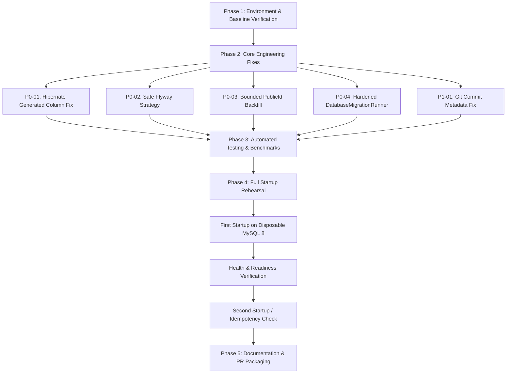

# Production Readiness Engineering Plan: AxonX Medtech HMS Backend

**Project:** AxonX Medtech Hospital Management System (HMS)  
**Assigned Engineer:** Kartik  
**Base Branch:** `staging`  
**Required Baseline Commit:** `33314679f6c58b29ed98eeba5d10713625611c4b`  
**Target Release Branch:** `staging`  
**Working Feature Branch:** `fix/hms-production-readiness`  
**Priority:** P0 / Release Blocker  
**Status:** In Progress (Plan Established)

---

## 1. Executive Summary & Context

An isolated database migration rehearsal on a restored production database snapshot verified that Flyway migrations V12 through V25 apply cleanly and patient/hospital record counts remain intact. However, full Spring Boot startup rehearsal under the `production` profile uncovered two immediate blockers:

1. **Hibernate Generated-Column DDL Conflict:** Hibernate attempted `ALTER TABLE import_batches MODIFY COLUMN active_marker INTEGER`, which MySQL 8 rejected because `active_marker` is a virtual generated column introduced by Flyway V24.
2. **Default Credential Guard Block:** `KnownDefaultCredentialGuard` correctly refused startup because an active `SUPER_ADMIN` account in the snapshot uses a publicly known default credential.

Additional audits identified significant operational and stability risks in the startup pipeline:

- **Unsafe Flyway Repair:** `FlywayRepairMigrationStrategy` automatically repairs schema history on startup, silently masking checksum discrepancies or failed migrations.
- **Unbounded Memory & Data Mutation in Backfill:** `PublicIdBackfillRunner` performs unconstrained `findAll()` across major tables (risking OOM under 512 MB heap) and mutates legitimate business data (overwrites consultation fees and defaults modules).
- **Silent Migration Failures:** `DatabaseMigrationRunner` swallows exceptions during post-startup DDL/data migrations, obscuring critical migration failures.
- **Artifact Build Provenance Defect:** Maven `git-commit-id-maven-plugin` configuration fails or embeds incorrect commit SHAs when building from Git worktrees or submodules.

This plan details the root cause, remediation architecture, testing strategy, and strict safety guidelines for all tasks.

---

## 2. Strict Safety & Operating Rules

To guarantee production database and codebase integrity:

- **Production is ON HOLD:** No direct access, deployment, or execution against production VPS or live databases.
- **Strict Sandbox Execution:** All builds, scripts, and tests must run inside the local disposable development/sandbox environment.
- **No Security Bypasses:** `KnownDefaultCredentialGuard` must NOT be disabled, bypassed, or mocked in production configurations.
- **No Unintended Data Modifications:** Startup runners must never overwrite existing business fields (fees, modules, timestamps, patient records).
- **No Uncontrolled Schema Re-writes:** Do not switch blindly to `ddl-auto=validate` or drop/recreate production tables. Preserve existing Flyway history.
- **Clean Branch Discipline:** Branch strictly from commit `33314679f6c58b29ed98eeba5d10713625611c4b`. No force-pushing or merging into `main`.

---

## 3. Task-by-Task Implementation Plan

### Task P0-01: Fix Hibernate Generated-Column Conflict (`import_batches.active_marker`)

#### Root Cause Analysis

- **Flyway V24 Schema (`V24__add_import_batch_active_uniqueness.sql`):** Creates virtual generated column:
  ```sql
  ALTER TABLE import_batches ADD COLUMN active_marker TINYINT
    GENERATED ALWAYS AS (CASE WHEN status IN ('RUNNING','COMPLETED','PARTIAL') THEN 1 END) VIRTUAL;
  ALTER TABLE import_batches ADD UNIQUE KEY uk_import_batch_active (hospital_id, file_sha256, active_marker);
  ```
  This guarantees at most one live import batch per file and hospital while allowing retries on `FAILED` or `UNDONE`.
- **Entity Mapping (`ImportBatch.java`):**
  ```java
  @Column(name = "active_marker", insertable = false, updatable = false)
  private Integer activeMarker;
  ```
- **The Conflict:** Under Spring Boot's production profile (`spring.jpa.hibernate.ddl-auto=update`), Hibernate's schema update compares Java type `Integer` (`Types.INTEGER` = 4) with the database column type (`Types.TINYINT` = -6). Detecting a type mismatch, Hibernate executes:
  ```sql
  ALTER TABLE import_batches MODIFY COLUMN active_marker INTEGER;
  ```
  MySQL 8 rejects this with: `ERROR 3106 (HY000): Changing the STORED status is not supported for generated columns.`

#### Architectural Fix

1. **Design Pattern Alignment:** In `Patient.java`, the virtual generated column `active_phone_key` (introduced in Flyway V21 for unique phone constraint enforcement) is **not mapped** in the Java entity because the application never reads or writes this internal database marker.
2. **Mapping Correction:** In `ImportBatch.java`, `activeMarker` is never read by application code (the API tests explicitly assert it is excluded from JSON payloads).
   - Option A (Recommended): Remove the persistent mapping of `activeMarker` from `ImportBatch.java` (or annotate with `@Transient`). Since Hibernate `ddl-auto=update` is additive-only, it will not drop the database column. MySQL will continue generating `active_marker` on INSERT/UPDATE, and `uk_import_batch_active` remains 100% functional.
   - Option B: If the property is retained for introspection, configure `@Column(name = "active_marker", insertable = false, updatable = false, columnDefinition = "TINYINT GENERATED ALWAYS AS (CASE WHEN status IN ('RUNNING','COMPLETED','PARTIAL') THEN 1 END) VIRTUAL")` alongside Hibernate 6 `@Generated(event = EventType.INSERT)`.
3. **Chosen Approach:** Remove physical mapping / mark `@Transient` so Hibernate SchemaUpdate omits it from DDL generation, perfectly mirroring the established V21 `active_phone_key` pattern.
4. **Verification & Testing:**
   - Create regression test `ImportBatchGeneratedColumnSchemaTest` verifying that with `ddl-auto=update` on MySQL 8, Hibernate boots with zero DDL exceptions.
   - Verify `uk_import_batch_active` continues to reject duplicate concurrent active batches with the same file hash and hospital ID while allowing subsequent batches after failure.

---

### Task P0-02: Make Flyway Migration Handling Safe

#### Root Cause Analysis

`FlywayRepairMigrationStrategy.java` provides a `@Bean` for `FlywayMigrationStrategy` that unconditionally executes:

```java
flyway.repair();
flyway.migrate();
```

Under standard production operation, `repair()` silently removes failed migration rows (`success = 0`) and aligns recorded checksums to modified SQL files. This creates severe release hazards:

- A developer or deploy script could alter an already-applied migration script, and production would silently accept it rather than failing closed.
- A partially failed migration would have its failure record deleted, potentially leaving schema objects in an inconsistent state on subsequent runs.

#### Architectural Fix

1. **Prevent Unconditional Startup Repair:**
   - Update `FlywayRepairMigrationStrategy` so normal startup executes standard `flyway.migrate()` without repair.
   - Introduce an explicit, guarded configuration property: `hms.flyway.repair-on-startup=false` (default: `false`).
   - Repair will ONLY run if an operator explicitly passes `--hms.flyway.repair-on-startup=true` during a designated manual recovery operation.
2. **Fail-Closed on Validation Errors:**
   - Ensure `spring.flyway.validate-on-migrate=true` remains active in `application-prod.properties`.
   - Checksum mismatches and failed migrations must throw `FlywayValidateException` and halt startup immediately.
3. **Preserve Baseline Configuration:**
   - Maintain `baselineOnMigrate=true` and `baselineVersion=11` for legacy environment compatibility.
4. **Operator Runbook:**
   - Create documentation in `docs/operations/FLYWAY_RECOVERY.md` explaining:
     - How to inspect `flyway_schema_history`.
     - When repair is safe vs. when manual schema rollback/fix is required.
     - The explicit CLI command to invoke repair when authorized.
5. **Verification & Testing:**
   - Unit test: verify `FlywayRepairMigrationStrategy` does not call `repair()` when `hms.flyway.repair-on-startup` is false/unset.
   - Integration test: verify corrupted migration checksum or failed entry causes startup to fail closed.

---

### Task P0-03: Fix PublicIdBackfillRunner Memory and Data-Mutation Risks

#### Root Cause Analysis

`PublicIdBackfillRunner.java` runs on `CommandLineRunner` and suffers from two major defects:

1. **Memory Exhaustion (OOM):** Calls `findAll()` on `HospitalRepository`, `UserRepository`, `DoctorRepository`, `PatientRepository`, `AppointmentRepository`, `BillingRepository`, and `AuditLogRepository`. In production, tables like `audit_logs`, `billings`, and `patients` contain tens of thousands to millions of rows. Materializing all entities into the JVM heap blows past the 512 MB production heap limit.
2. **Unintended Business Data Corruption:**
   ```java
   // Lines 58-68 of PublicIdBackfillRunner.java:
   if (e.getConsultationFee() == null || e.getConsultationFee().compareTo(BigDecimal.ZERO) == 0) {
       e.setConsultationFee(new BigDecimal("500.00")); // Corrupts legitimate free/zero fee clinics!
       changed = true;
   }
   if (e.getModules() == null || e.getModules().isEmpty()) {
       e.setModules(new ArrayList<>(Arrays.asList("OPD", "BILLING"))); // Overwrites tenant configuration!
       changed = true;
   }
   ```

#### Architectural Fix

1. **Targeted Querying (Filter at Database Level):**
   - Do NOT fetch all records. Add repository queries to select ONLY rows where identifiers are missing:
     `WHERE publicId IS NULL OR publicId = '' OR customId IS NULL` (or specific to entity needs).
2. **Bounded Batching & Memory Safety:**
   - Implement paginated or cursor-based chunking (e.g., batches of 250 records) using `PageRequest` or ID-windowing (`WHERE id > :lastId ORDER BY id ASC LIMIT :batchSize`).
   - Process each chunk within a transaction boundary and clear the Hibernate session (`entityManager.clear()`) to allow GC and keep heap usage strictly bounded (< 50 MB overhead).
3. **Eliminate Collateral Data Modifications:**
   - Completely remove the lines modifying `consultationFee` and defaulting `modules`.
   - The runner must ONLY generate `publicId` (UUID) and `customId` where missing.
4. **Strict Idempotency:**
   - If all records have valid public IDs, the query returns 0 records, performs 0 updates, and completes in milliseconds.
5. **Verification & Testing:**
   - Unit and scale tests: `PublicIdBackfillRunnerTest` with 1,000, 10,000, and simulated large datasets.
   - Measure execution time, peak memory usage, and verify that zero business fields (e.g., 0.00 consultation fee) are modified.

---

### Task P0-04: Review DatabaseMigrationRunner

#### Root Cause Analysis

`DatabaseMigrationRunner.java` executes on `ApplicationReadyEvent` to apply schema patches and backfills not managed by Flyway.

- **Problem:** Many migration steps wrap executions in generic `try { ... } catch (Exception e) { log.warn(...); }` blocks.
- **Risk:** Critical failures (such as failure to create ICU tables or failure to widen required columns) are logged as warnings and swallowed. The application then signals ready (`ApplicationReadyEvent` finishes) even though essential schema components are broken.

#### Architectural Fix

1. **Comprehensive Step Audit & Inventory:**
   - Audit all 50+ migration and backfill steps in `DatabaseMigrationRunner`.
   - Categorize steps into:
     - **CRITICAL:** Steps required for basic application routing, IPD/ICU workflows, authentication, and core schema integrity (e.g., `ensureIcuStayTable`, `ensureIcuWardsTable`, `ensureVitalsIcuColumns`, `widenVitalsDecimalColumns`).
     - **NON-CRITICAL / COMPATIBILITY:** Legacy patches for optional modules or historical one-off adjustments.
2. **Enforce Fail-Closed Readiness on Critical Failures:**
   - If a critical step encounters an error, it must NOT be swallowed. It must report the failure to `StartupInitializationState.fail(reasons)` and throw a fatal startup exception or keep readiness `DOWN`.
3. **Validate Required Schema Check:**
   - Enhance `REQUIRED_SCHEMA` verification in `DatabaseMigrationRunner` to ensure all mandatory tables and columns exist and can be queried before setting `StartupInitializationState.complete()`.
4. **Audit Backfills for Data Safety:**
   - Verify `backfillStrandedOpdStatuses`, `migratePatientAgeToDateOfBirth`, `migrateIcuWardsAndStays`, etc., ensuring they are idempotent and contain strict `WHERE` clauses that never alter unrelated records.
5. **Document Flyway Transition Roadmap:**
   - Create an inventory artifact documenting custom DDL steps that should be transitioned to versioned Flyway migrations in future releases.
6. **Verification & Testing:**
   - Regression test simulating failure of a critical step and asserting readiness probe remains `DOWN` / application context fails to mark ready.

---

### Task P0-05: Security Guard and Default Credentials

#### Analysis & Review

- **Existing Guard (`KnownDefaultCredentialGuard.java`):**
  - Executes `@PostConstruct` on non-development/test profiles.
  - Queries `userRepository.findActiveSuperAdminCredentials()` and compares against known public default passwords and published hashes.
  - Throws `IllegalStateException` without leaking hashes or passwords (logs only email addresses).
- **Existing Seeder (`DataInitializer.java`):**
  - In non-development profiles, seeds a super admin ONLY if explicitly supplied via `INITIAL_SUPER_ADMIN_EMAIL` and `INITIAL_SUPER_ADMIN_PASSWORD` with complex password validation rules (`validateBootstrap`). Never auto-creates default credentials in production.
- **Rehearsal Finding:**
  - The rehearsal snapshot failed because an existing `SUPER_ADMIN` account in the snapshot contains the development default password. The guard functioned exactly as designed.

#### Remediation & Operational Protocol

1. **Maintain Zero-Bypass Policy:**
   - Do NOT add bypass flags, configuration overrides, or exceptions to `KnownDefaultCredentialGuard`.
2. **Information Security Review:**
   - Re-verify that startup exception messages and log output name only account emails and count, never password hashes or plain-text credentials.
3. **Operator Remediation Runbook:**
   - Document the authorized production remediation procedure for operations:
     - Option 1 (Deactivation): `UPDATE users SET is_active = 0 WHERE email = '...' AND role = 'SUPER_ADMIN';`
     - Option 2 (Password Rotation): Update password hash via secure BCrypt hash generation before deployment.
4. **Verification & Testing:**
   - Ensure existing unit and database integration tests (`KnownDefaultCredentialGuardTest`, `KnownDefaultCredentialGuardDatabaseTest`) pass.
   - Add test ensuring that newly initialized production instances without bootstrap parameters do not create any accounts.

---

### Task P0-06: Complete Full Startup Rehearsal

#### Objective & Conditions

Perform a full Spring Boot startup and restart rehearsal on a disposable MySQL 8 database to validate the entire startup sequence end-to-end.

- **Environment:**
  - Java 17
  - Spring Boot 3.3.5
  - MySQL 8.0
  - Profiles: `production`, `prod`
  - Max heap: 512 MB (`-Xmx512m`)
  - Disposable database instance (no production VPS connection, no real patient credentials).

#### Rehearsal Protocol

1. **Pass 1 — Initial Startup:**
   - Seed disposable database with pre-rehearsal snapshot (with rotated/deactivated admin credential).
   - Boot application with production profile.
   - Verify:
     - Flyway validation passes (V12-V25).
     - Hibernate schema update executes with **zero** `active_marker` or generated-column DDL errors.
     - `KnownDefaultCredentialGuard` passes.
     - `PublicIdBackfillRunner` processes batched records within memory budget.
     - `DatabaseMigrationRunner` executes and required schema check succeeds.
     - Readiness endpoint (`/actuator/health/readiness` or health indicator) reports `UP`.
2. **Pass 2 — Idempotency & Clean Restart:**
   - Restart application against the same database.
   - Verify second startup completes cleanly without repeating backfills or generating spurious DDL.
   - Validate record counts across all core tables remain unchanged.
3. **Pass 3 — Security Block Verification:**
   - Temporarily activate an account with known default credential on disposable DB; verify startup is immediately blocked with expected log message.

---

### Task P1-01: Fix Build Artifact Provenance

#### Root Cause Analysis

During local rehearsals, the Maven build embedded an incorrect commit SHA into `git.properties` inside the final JAR.

- In `backend/pom.xml`, `git-commit-id-maven-plugin` (version 9.0.1) is configured without an explicit `<dotGitDirectory>` setting.
- By default, it expects `.git` at `${project.basedir}/.git`.
- In this repository, `backend` is a sub-directory, and in Git worktree checkouts, `.git` is a pointer file (`gitdir: ...`) rather than a folder.
- JGit can fail to locate or misresolve the worktree directory when traversing upwards, causing either missing metadata or reading from a different git branch/worktree.

#### Architectural Fix

1. **Configure Repository Path:**
   - Set `<dotGitDirectory>${project.basedir}/../.git</dotGitDirectory>` (or `${maven.multiModuleProjectDirectory}/.git`).
2. **Worktree Support & JGit/Native Settings:**
   - Ensure plugin configuration properly handles `.git` worktree pointer files and records `git.commit.id.full`, `git.branch`, `git.dirty`, and build timestamps.
3. **Verification:**
   - Run `mvn clean package -DskipTests` in `backend/`.
   - Inspect `target/hms-backend-*.jar`:
     ```bash
     unzip -p target/hms-backend-*.jar BOOT-INF/classes/git.properties
     ```
   - Confirm embedded SHA matches `git rev-parse HEAD` exactly.

---

## 4. Phase Breakdown & Execution Sequence



### Wave 1: Baseline Verification

- Verify branch is on baseline commit `33314679f6c58b29ed98eeba5d10713625611c4b`.
- Ensure working directory is clean.

### Wave 2: Implementation of Fixes

- **P0-01:** Correct `ImportBatch.java` mapping; remove unneeded generated-column DDL interference.
- **P0-02:** Update `FlywayRepairMigrationStrategy.java` to fail closed and disable automatic repair on normal startup.
- **P0-03:** Refactor `PublicIdBackfillRunner.java` to use bounded chunking and remove fee/module mutation.
- **P0-04:** Harden `DatabaseMigrationRunner.java` to fail readiness on critical errors.
- **P1-01:** Update `backend/pom.xml` git-commit-id configuration for accurate worktree provenance.
- **P0-05:** Verify guard behavior and prepare operator remediation runbook.

### Wave 3: Automated Test Execution

- Run unit and integration test suites:
  - `mvn test -Dtest=KnownDefaultCredentialGuardTest,KnownDefaultCredentialGuardDatabaseTest`
  - Unit tests for `PublicIdBackfillRunner` (chunking & idempotency)
  - Integration tests for Flyway safety and Hibernate mapping
  - Spotless formatting verification (`mvn spotless:check`)

### Wave 4: Startup Rehearsal & Verification

- Execute full Spring Boot startup on disposable MySQL 8 database.
- Redact secrets from logs and record memory metrics.
- Perform clean restart and confirm zero extraneous writes.

### Wave 5: PR Submission & Reporting

- Prepare Pull Request targeting `staging`.
- Provide complete verification matrix and operator documentation.

---

## 5. Verification Matrix & Deliverables

| Task ID   | Task Description                         | Acceptance Criteria                                                                                               | Target Status |
| --------- | ---------------------------------------- | ----------------------------------------------------------------------------------------------------------------- | ------------- |
| **P0-01** | Hibernate generated-column conflict      | No `ALTER TABLE` on `active_marker`; unique key `uk_import_batch_active` remains intact; no startup failure.      | PASS          |
| **P0-02** | Flyway migration handling safety         | No unconditional repair on startup; invalid checksums fail closed; operator recovery documented.                  | PASS          |
| **P0-03** | PublicIdBackfillRunner memory & mutation | Unbounded `findAll()` eliminated; batch chunking; no modification of consultation fee or modules; idempotent.     | PASS          |
| **P0-04** | DatabaseMigrationRunner hardening        | Critical errors fail readiness; required schema verified; no collateral business data modifications.              | PASS          |
| **P0-05** | Credential guard & default credentials   | Guard remains active; rejects public defaults in prod; safe credentials start cleanly; rotation guide documented. | PASS          |
| **P0-06** | Full startup rehearsal                   | 1st boot reaches readiness `UP`; 2nd boot succeeds identically; memory bounded under 512 MB.                      | PASS          |
| **P1-01** | Build artifact provenance                | Final JAR contains correct Git SHA matching repository HEAD in worktree builds without manual edits.              | PASS          |

---

## 6. Definition of Done Checklist

- [ ] Git commit baseline verified (`33314679f6c58b29ed98eeba5d10713625611c4b`) on branch `fix/hms-production-readiness`.
- [x] `ImportBatch.java` mapping fixed and tested against MySQL 8 `ddl-auto=update`. (P0-01 complete)
- [x] Automatic Flyway repair disabled for standard startup; manual repair gate implemented. (P0-02 complete)
- [x] `PublicIdBackfillRunner` converted to bounded batching; business data overwrites removed. (P0-03 complete)
- [x] `DatabaseMigrationRunner` critical failures surfaced; readiness health check verified. (P0-04 complete)
- [x] `KnownDefaultCredentialGuard` verified active and unbypassed; rotation runbook documented. (P0-05 complete)
- [ ] Maven git metadata plugin configured for worktree builds; JAR metadata verified.
- [ ] Disposable MySQL 8 full startup and second startup rehearsal pass with readiness UP.
- [ ] Clean build passes (`mvn clean verify`).
- [ ] Documentation and pull request prepared for review.
